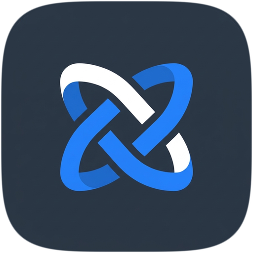

<p align="center">
  <b>ReDisplay</b>
</p>

<p align="center">
  
</p>

<p align="center">
  <b>轻巧易用，一线畅联</b>
</p>
<p align="center">
  <b>基于 IddCx + NVENC 的 Windows 低延迟高刷 Android 副屏</b>
</p>

<p align="center">
  
  
  
  
</p>


ReDisplay 是一套开源、全链路硬件加速的超低延迟有线副屏拓展系统。基于高速 USB 3.2 Type-C 线缆，将安卓设备无缝接入 Windows ，作为原生高刷新率副屏。

## 🎉 版本更新 V1.3.2

### 与 V1.2.1 相比


- **触控与手写**：增加对多指触摸和笔压转发的支持，从 Android 设备直接操控 Windows。
- **码率热调整**：调整码率时可在线应用，无需重载画面。
- **刷新率调度**：默认优先匹配设备支持的刷新率，按解码器启用低延迟模式。
- **会话可认证**：连接使用独立的会话端点和密钥，更安全的通信机制。
- **布局更清晰**：全新的遥测页面，层次分明，层级重构。
- **Android 界面更新**：全新的安卓端UI/UX，简洁易用，清爽流畅

## ✨ 功能/特性

- **2.8K 180+ Hz**：“拉满”帧率画质
- **硬件编码 < 3ms**：针对硬件优化
- **全链路 < 15ms**：灵动无感延迟
- **参数随心调控**：参数自主可控
- **平板输入回传**：触控手写支持
- **实时状态遥测**：完整性能报告
- **智能设备握手**：自动生成驱动
- **线材实时测速**：可视链路速率
- **软件开箱即用**：解压即可运行
- **MD 设计风格**：界面清爽统一
- **自动设备唤醒**：亮屏无需解锁
- **自动重连常驻**：断线自动恢复
- **多设备热插拔**：插拔即连即用
- **中英双语切换**：语言一键切换
- **多彩配色随心**：主题自由搭配

## 🚀 快速上手

### 1. 准备工作
- **操作系统**: Windows 10/11 + NVIDIA 显卡 (需支持 NVENC)
- **安卓设备**: Snapdragon + Android 11+
- **开启调试**: 安卓端【设置】→【开发者选项】中开启【USB 调试】。
- **连接线材（建议）**: USB 3.2 Gen 2 (或更高)
> 需要 [Visual C++ x64 Redistributable](https://learn.microsoft.com/en-us/cpp/windows/latest-supported-vc-redist)。

>需要 [Android SDK Platform-Tools](https://developer.android.com/tools/releases/platform-tools)

### 2. 启动服务
- 访问 Releases 下载 `ReDisplay-v1.3.2-Win64.zip`，解压后双击 `ReDisplay.exe` 打开控制中心。
- 首次运行服务可能需要提升的管理员身份以**安装或更新 Android 应用/安装虚拟屏幕驱动**
- 首次使用可于「连接 → 设置 ADB → 同意并下载」从 Google 下载最新Android SDK Platform-Tools，也可自行配置或选择含 adb.exe 的 platform-tools 文件夹。


## 📊 实测数据

Windows 11 24H2 + Android 16 + USB 3.2 Gen2 下：

### 性能演进

| 版本 | 目标 FPS | 有效轮数 | 图层呈现 FPS | 呈现间隔 P95 | 间隔 > 12.5 ms | 图层就绪至呈现 P95 |
| :---: | ---: | ---: | ---: | ---: | ---: | ---: |
| V1.0.0 | 120 | 5 | 85.56 | 16.67 ms | 39.52% | 15.85 ms |
| V1.2.1 | 120 | 5 | **110.23** | 16.67 ms | 8.72% | 14.90 ms |
| **V1.3.0** | 120 | 5 | 108.91 | 16.67 ms | 10.11% | **14.31 ms** |

### 版本优化

在引入大量新功能的前提下，V1.3.0基本保持了V1.2.1的高水准，且我们着重优化了编码P95水平

| 目标 FPS | 版本 | Host 发送 FPS | Android 提交 FPS | 图层呈现 FPS | 呈现间隔 P95 | 编码 P95 |
| :---: | :---: | :---: | :---: | :---: | :---: | :---: |
|120|V1.1.0|120.0|120.0|116.69|8.33–16.67 ms|3.60 ms|
|120|V1.2.0|120.0|119.9|**119.01**|**8.33 ms**|3.62 ms|
|120|**V1.3.0**|119.8|119.9|113.11|16.67 ms|**2.81 ms**|
|180|V1.1.0|179.8|179.6|179.38|8.33 ms|2.72 ms|
|180|V1.2.0|179.9|179.8|**179.60**|8.33 ms|2.71 ms|
|180|**V1.3.0**|180.1|**179.8**|179.34|8.33 ms|**2.68 ms**|

> 我们建议，无需使用 V1.3.X 版本中新增的触控/手写笔支持功能的用户继续使用性能优化最佳的 V1.2.1 版本以获得最佳副屏使用体验

## 📐 低延迟架构


```
[ Windows Desktop ]
         |
         ▼
(Stage 1) IddCx → Windows DWM
         |
         ▼
(Stage 2) Windows.Graphics.Capture
         |
         ▼
(Stage 3) NVIDIA NVENC (P1) 
         |
         ▼
(Stage 4) Host TCP
         |  (USB 3.2 Gen 2 (+) ) Cable
         ▼
(Stage 5) Android ADB Tunnel TCP
         |
         ▼
(Stage 6) Qualcomm Snapdragon MediaCodec
         |
         ▼
(Stage 7) SurfaceFlinger
```

### 🔧 多层级优化

- **WGC 多缓冲管线 —— W.G.C 3-Buffer Drop-to-Latest Pipeline**
- **NVENC 纹理注册缓存 —— NVENC Texture Registration Cache**
- **高通编解码器 2.0 —— Qualcomm Codec 2.0**
- **高精度时钟调度 —— WaitableTimerExW**
- **聚合防粘包传输 —— W.S.A Send**
- **单调硬件 PTS —— SurfaceFlinger**
- 以及更多，详见技术文档

## 📄 开源许可证与声明

- ReDisplay 遵循 [MIT](LICENSE) 开源协议。
  - 第三方组件遵循各自许可证，详见 [NOTICE.md](NOTICE.md)。