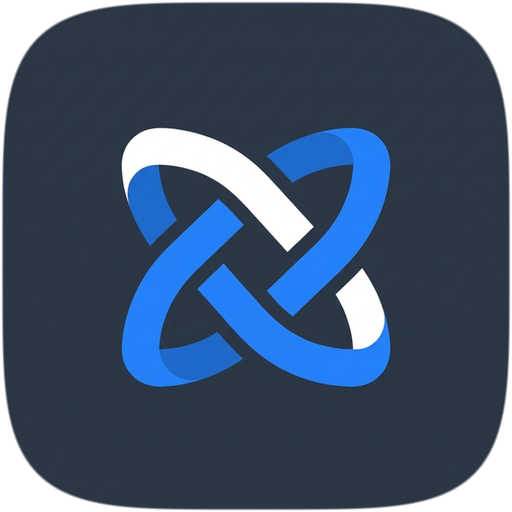

<p align="center">
  <b>ReDisplay</b>
</p>

<p align="center">
  
</p>

<p align="center">
  <b>轻巧易用，一线畅联</b>
</p>
<p align="center">
  <b>基于 IddCx + NVENC 的 Windows 低延迟高刷 Android 副屏</b>
</p>

<p align="center">
  
  
  
  
</p>


ReDisplay 是一套开源、全链路硬件加速的超低延迟有线副屏拓展系统。基于高速 USB 3.2 Type-C 线缆，将安卓设备无缝接入 Windows ，作为原生高刷新率副屏。

## 🎉 版本更新 V1.2.0 ！

### 与 V1.1.0 相比：

- **更加智能**的设备适配：读取设备原生分辨率，生成**定制驱动配置**
- **更加优雅**的用户界面：全新的控制中心，带来**崭新的界面交互体验**
- **更加流畅**的呈现体验：优化串流帧率与面板帧率的同步效果，**减少匹配卡顿**
- **更加可靠**的连接体验：全面支持**自动的**驱动安装、设备识别、重连响应与睡眠唤醒
- **更加专业**的性能诊断：完整**链路遥测/监控**，支持 JSON 性能报告导出
- **更加灵活**的画面控制：新增**多种编码预设**，画面参数自由调配（Preview）

## ✨ 功能/特性

- **2.8K 180+ Hz**：“拉满”帧率画质
- **硬件编码 < 3ms**：针对硬件优化
- **全链路 < 15ms**：灵动无感延迟
- **参数随心调控**：参数自主可控
- **实时状态遥测**：完整性能报告
- **智能设备握手**：自动生成驱动
- **线材实时测速**：可视链路速率
- **软件开箱即用**：解压即可运行
- **MD 设计风格**：界面清爽统一
- **自动设备唤醒**：亮屏无需解锁
- **自动重连常驻**：断线自动恢复
- **多设备热插拔**：插拔即连即用
- **中英双语切换**：语言一键切换
- **多彩配色随心**：主题自由搭配

## 🚀 快速上手

### 1. 准备工作
- **操作系统**: Windows 10/11 + NVIDIA 显卡 (需支持 NVENC)
- **安卓设备**: Snapdragon + Android 11+
- **开启调试**: 安卓端【设置】→【开发者选项】中开启【USB 调试】。
- **连接线材（建议）**: USB 3.2 Gen 2 (或更高)
> 需要 [Visual C++ x64 Redistributable](https://learn.microsoft.com/en-us/cpp/windows/latest-supported-vc-redist)。

### 2. 启动服务
- 访问 Releases 下载 `ReDisplay-v1.2.0-Win64.zip`，解压后双击运行 `ReDisplay.exe` 即可打开控制面板。
- 首次运行服务可能需要提升的管理员身份以**安装虚拟屏幕驱动/为安卓设备推送APK**

## 📊 实测数据

Windows 11 + Android 16 + USB 3.2 Gen2 下：

### 性能演进

|版本|目标 FPS|实际呈现 FPS|呈现间隔 P95|间隔 > 12.5 ms|图层就绪至呈现 P95|
|:---:|:---:|:---:|:---:|:---:|:---:|
|V1.0.0|120|102.5|16.67 ms|16.9%|15.47 ms|
|V1.1.0|120|111.3|16.67 ms|7.5%|15.91 ms|
|**V1.2.0**|120|**119.01**|**8.33 ms**|N/A%|**13.71 ms**|

### 版本优化

|目标 FPS|版本|Host 发送 FPS|Android 提交 FPS|实际呈现 FPS|呈现间隔 P95|编码 P95|
|:---:|:---:|:---:|:---:|:---:|:---:|:---:|
|**120**|V1.1.0|120.0|120.0|116.69|8.33–16.67 ms|3.60 ms|基准版本|
|**120**|**V1.2.0**|**120.0**|**119.9**|**119.01**|**8.33 ms**|3.62 ms|
|**180**|V1.1.0|179.8|179.6|179.38|8.33 ms|2.72 ms|
|**180**|**V1.2.0**|**179.9**|**179.8**|**179.60**|**8.33 ms**|**2.71 ms**|

> 测试基于 Nvidia RTX 5070Ti + Snapdragon 8 Gen 3，测试分辨率：2800 x 1752

## 📐 低延迟架构


```
[ Windows Desktop ]
         |
         ▼
(Stage 1) IddCx → Windows DWM
         |
         ▼
(Stage 2) Windows.Graphics.Capture
         |
         ▼
(Stage 3) NVIDIA NVENC (P1) 
         |
         ▼
(Stage 4) Host TCP
         |  (USB 3.2 Gen 2 (+) ) Cable
         ▼
(Stage 5) Android ADB Tunnel TCP
         |
         ▼
(Stage 6) Qualcomm Snapdragon MediaCodec
         |
         ▼
(Stage 7) SurfaceFlinger
```

### 🔧 多层级优化

- **WGC 多缓冲管线 —— W.G.C 3-Buffer Drop-to-Latest Pipeline**
- **NVENC 纹理注册缓存 —— NVENC Texture Registration Cache**
- **高通编解码器 2.0 —— Qualcomm Codec 2.0**
- **高精度时钟调度 —— WaitableTimerExW**
- **聚合防粘包传输 —— W.S.A Send**
- **单调硬件 PTS —— SurfaceFlinger**
- 以及更多，详见技术文档

## 📄 开源许可证与声明

- ReDisplay 遵循 [MIT](LICENSE) 开源协议。
  - 第三方组件遵循各自许可证，详见 [NOTICE.md](NOTICE.md)。